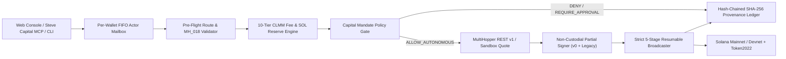

# SolRouteMandate (`@lbcron/solroute-mandate`)

**Autonomous Solana Capital Agent, Enforceable Mandate Policy Kernel & Programmable MultiHopper Treasury Router**

`SolRouteMandate` is a non-custodial TypeScript SDK, JSON-RPC 2.0 Model Context Protocol (MCP) server, HMAC-SHA256 webhook engine, and operations console for delegating programmable multi-hop and multi-destination Solana treasury settlements under strict, auditable capital guardrails.

Built for the **OOBE Protocol / Steve Capital Autonomous Capital Agent** ecosystem and the **MultiHopper Programmable Asset Routing** protocol on Solana (`SOL`, `USDC`, `USDG`, and `Token2022` wrapper mints).

---

## Architecture Overview



### Key Technical Capabilities

1. **Exact On-Chain 10-Tier Fee & 50/50 Revenue-Share Engine (`src/protocol/pricingEngine.ts`)**
   - Reproduces MultiHopper's live on-chain fee schedule (`tier_0` `<= $50` at `0` flat fee through `tier_9` `> $500` at `2,000,000` lamports/hop) to the single lamport (`1 SOL @ $120, 3 hops` -> `hopAmountRaw = 993,905,472`, `percentFeeRaw = 4,969,527`, atomic 50% integrator share `= 2,484,763` lamports).
   - Resolves tier-boundary discontinuities (`cappedAtTierBoundary: true`), TRM Labs compliance screening fees (`0.002 SOL` per screened wallet on Mainnet), refundable orchestrator/dispersion rent, and multi-destination proportional post-fee payouts (`MH_017` `890,880`-lamport rent-exemption guard).
2. **Enforceable Capital Mandate Kernel & Per-Wallet Actor Mailbox (`src/agent/mandateKernel.ts`)**
   - Modeled on the **Steve Kernel / Synapse Agent Protocol (SAP)** execution pipeline:
     - **FIFO Actor Mailbox** serializes concurrent commands per wallet so parallel agent turns can never race on rolling 24h spend budgets.
     - **Configurable Guardrails**: `maxSingleTransferUsd`, rolling 24-hour `maxDailySpendUsd`, `requireHumanApprovalAboveUsd` co-signature threshold, `minSolReserveLamports` floor, mint allowlists (`SOL`, `USDC`, `USDG`), recipient allow/denylists, and an instant `emergencyHalt` kill-switch.
     - **Hash-Chained SHA-256 Provenance Receipts** emitted for every allowed, gated, or denied action.
3. **Non-Custodial Client-Side Partial Signer & 5-Stage Resumable Broadcaster (`src/protocol/txSignerBroadcaster.ts`)**
   - Private keys never leave the client runtime.
   - Attaches `sourceOwner` Ed25519 signatures to `VersionedTransaction (v0)` bundles (`keeperFundingTx`, `routeInitTxs[]`, `sessionInitTxs[]`, `dispersionInitTxs[]`) **without overwriting server-applied ephemeral keypair partial signatures**, and partially signs Legacy `orchestratorInitTx`.
   - Enforces the strict 5-stage broadcast sequence with **two-phase `confirm-broadcast`** (recording `keeperFundingSignature` immediately after Stage 1 to prevent double-funding if a Solana blockhash expires mid-deployment, and skipping `null` groups on idempotent `/prepare` resume).
4. **Deterministic Solana Anchor PDA Inspector (`src/protocol/multihopperPdas.ts`)**
   - Derives all 11 protocol PDAs (`RouteConfig`, `RouteState`, `PermanentDelegate`, `WrapperMint`, `Vault`, `SolVault`, `TokenConfig`, `Provider`, `FeeSchedule`, `OrchestratorConfig`, `OrchestratorStep`) and verifies live executable status on Solana Mainnet-Beta:
     - **MultiHopper Core**: `3jLoS2wbNgtKzieUUxwg6Xhdv6gbZkHDtPWA9ZAgspFh`
     - **MultiHopper Orchestrator**: `4TPCmR2uN3hDM1FbTsf7ZtFXwXGSz4u1Kxv5YHj6eruX`
     - **Token2022 Transfer Hook Guard**: `2JEv3pD6nczEvn1xDXaEzehkJofPPjoQQpnW5nGY3r52`
5. **Pre-Flight Custom Route Validator (`src/protocol/routeValidator.ts`) & HMAC Webhook Router (`src/protocol/webhookVerifier.ts`)**
   - Catches all custom route rule violations simultaneously (`MH_018`) and devnet hop-library mismatches (`MH_019`) locally before consuming API rate limits (`10 req/60s`).
   - Verifies `x-multihopper-signature` headers via constant-time `crypto.timingSafeEqual` and deduplicates retries across all 13 lifecycle events.
6. **Standards-Compliant MCP Server (`src/mcp/mcpServer.ts`, `src/mcp/stdio.ts`)**
   - Exposes `quote_multihopper_route`, `validate_custom_route`, `derive_multihopper_pdas`, `execute_mandate_routed_transfer`, `verify_mainnet_programs`, and `get_provenance_ledger` over JSON-RPC 2.0 (`protocolVersion: "2025-06-18"`) for **Steve Capital MCP Workspace**, **Claude Code**, and **Cursor**, plus live tool discovery against `https://multihopper.com/api/mcp`.

---

## Quickstart

Zero paid API keys are required to build, test, or run the interactive console and autonomous demo. When `MH_API_KEY` (`mh_test_...` or `mh_live_...`) and `SOLANA_PRIVATE_KEY` are set, `SolRouteMandate` switches seamlessly from its cryptographic local sandbox to live MultiHopper Devnet/Mainnet execution.

```bash
npm install
npm run typecheck
npm run build
npm test
```

### Run the Autonomous Multi-Destination Payroll Demo

```bash
npm run demo
```

### Verify MultiHopper Anchor Programs Live on Solana Mainnet

```bash
npm run verify:mainnet
```

### Launch the Operations Console & HTTP/MCP Server

```bash
npm start
# Open http://127.0.0.1:4173
```

---

## Connecting to Steve Capital MCP Workspace / Claude / Cursor

### Stdio MCP Server

```json
{
  "mcpServers": {
    "solroute-mandate": {
      "command": "npx",
      "args": ["tsx", "src/mcp/stdio.ts"],
      "env": {
        "SOLANA_RPC_URL": "https://api.mainnet-beta.solana.com"
      }
    }
  }
}
```

### Streamable HTTP JSON-RPC Endpoint

When running `npm start`, POST JSON-RPC 2.0 requests to `http://127.0.0.1:4173/api/mcp` (`initialize`, `tools/list`, `tools/call`).

---

## Project Layout

```text
solroute-mandate/
├── public/
│   ├── index.html                    # Operations Console UI
│   ├── styles.css                    # Semantic design tokens & responsive layout
│   └── app.js                        # Quote composer, mandate controls & PDA inspector
├── src/
│   ├── agent/
│   │   └── mandateKernel.ts          # FIFO Actor Mailbox, Mandate Policy Gate & Provenance Ledger
│   ├── mcp/
│   │   ├── mcpServer.ts              # JSON-RPC 2.0 MCP server & live MultiHopper MCP discovery
│   │   └── stdio.ts                  # Stdio transport entrypoint
│   ├── protocol/
│   │   ├── multihopperClient.ts      # Live REST v1 client + cryptographic v0/Legacy sandbox
│   │   ├── multihopperPdas.ts        # All 11 Anchor PDAs + Mainnet RPC program verifier
│   │   ├── pricingEngine.ts          # 10-tier fee schedule, boundary cap & 50/50 split math
│   │   ├── routeValidator.ts         # Pre-flight MH_018 / MH_019 / MH_017 validator
│   │   ├── txSignerBroadcaster.ts    # Partial v0/Legacy signer & 5-stage resumable broadcaster
│   │   └── webhookVerifier.ts        # Timing-safe HMAC-SHA256 verifier & deduplicating router
│   ├── server/
│   │   └── appServer.ts              # HTTP REST, Webhook, MCP & Console server
│   ├── cli.ts                        # CLI entrypoint (serve | demo | verify-mainnet)
│   ├── index.ts                      # Public SDK exports
│   └── types.ts                      # Strict TypeScript protocol & mandate interfaces
└── tests/
    ├── pricingAndPdas.test.ts        # Exact lamport parity, tier cap, MH_017 & 11-PDA suite
    ├── routeValidatorAndSigning.test.ts # MH_018/019, v0 partial sigs & blockhash-expiry resume
    └── mandateWebhookAndServer.test.ts  # Actor mailbox concurrency, HMAC & HTTP/MCP E2E tests
```

---

## License

MIT © LBCron (`32647Bri8KhJQE11x26iF7fpae9nouCJSZ8Y2VPpq5yM`)
